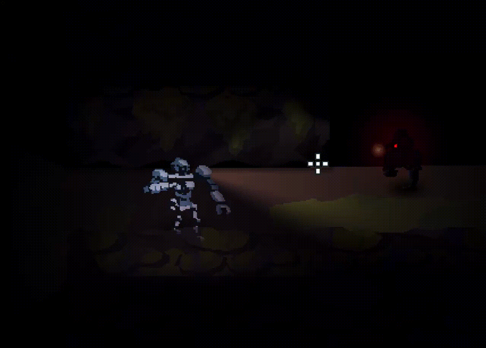

# Robot Mining Game

Mine ore, upgrade your robot, and survive. Better modules improve your chances, but every run puts them at risk. If you die, your equipped upgrades are lost.

**[Play in your browser](https://ivankuzo.github.io/near-hackathon-game/)**



## Game loop

1. Break rocks, collect ore, and avoid enemies.
2. Survive the run to sell your ore for credits.
3. Buy and equip modules for your next run.
4. Decide how far to push. More ore means more rewards, but also more risk.

**Controls:** WASD to move, mouse to aim, left click to shoot.

## Economy

The economy turns ore into upgrades and combat losses into demand for new modules.

On NEAR Testnet:

- Ore, credits, and modules use **NEP-245**.
- Players can place market orders and craft modules from ore.
- An NPC trader uses its own wallet to buy ore, craft modules, and sell them. Its buy prices respond to its ore stock.
- A relayer can sponsor transactions signed by the player.
- Lost modules are removed from the economy.

## Verify on NEAR Testnet

Contract: `robot-contract-7133014f3f.testnet`

From the `economy` directory:

```bash
npm ci
npm test
npm run verify:testnet
```

These commands run the tests and check recorded transactions for ore sales, module crafting, purchases, and losses. No wallet is needed.

For setup and a complete transaction scenario, see [economy/README.md](economy/README.md).

## Run locally

Open `game/` in Godot 4.7 and press **F5**.

## Built with

Godot, GDScript, Rust, NEAR, NEP-245, and NEP-366.
